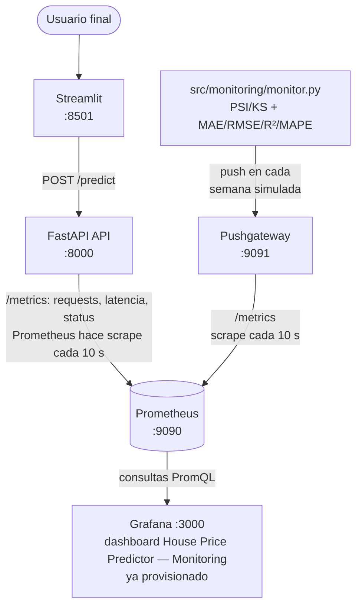

# 🛠️ Monitoreo del Modelo: FastAPI + Prometheus + Grafana

## 🎯 Objetivo

Monitorear el modelo de predicción de precios de casas (`mlops-lab`) en dos capas, según el framework estándar de monitoreo MLOps:

1. **Infra / API (nivel request):** requests/sec, latencia, status codes — vía `prometheus-fastapi-instrumentator`.
2. **Modelo (nivel ML):**
   - **Data Drift:** ¿los datos actuales se parecen a los de entrenamiento? Se mide con **PSI** (Population Stability Index) y **KS Test** por feature.
   - **Model Drift (performance):** ¿el modelo sigue siendo tan bueno como cuando se entrenó? Se mide con **MAE, RMSE, R², MAPE** (es un modelo de regresión — precio de casas).

3. **Monitoreo programado (sección 9):** un job semanal de GitHub Actions mide **decaimiento + PSI** y, si cruzan su umbral, **dispara el reentrenamiento**. Es el patrón del pipeline presentado en MICAI 2026.

Todo corre local con Docker — Prometheus, Pushgateway y Grafana — sin gastar en servicios cloud (Amazon CloudWatch / SageMaker Model Monitor serían el equivalente productivo en AWS).

---

## ✅ Prerrequisitos

- **Modelo entrenado en local:** `models/trained/house_price_model.pkl` y `preprocessor.pkl` (guía 3). Los `.pkl` están en `.gitignore`, así que no vienen con el `git clone`: si no los tienes, corre `python src/models/train_model.py` como en la guía 3. Sin ellos, `monitor.py` falla con `FileNotFoundError` y la imagen de la API arranca sin modelo.
- **`data/processed/featured_house_data.csv`** con la columna `split` (guía 2).
- **Docker** corriendo (Docker Desktop u OrbStack).
- **Solo para la sección 9:** al menos una corrida exitosa de `mlops-pipeline.yml` con los jobs de las guías 3 y 5, porque el job programado descarga sus artefactos.

Ya vienen en la plantilla: el `Instrumentator` en `src/api/main.py`, las dependencias de monitoreo y todo `deployment/monitoring/`. Tú escribes `src/monitoring/monitor.py`, `src/monitoring/drift_check.py`, `scripts/simulate_api_traffic.sh` y `.github/workflows/drift-retrain.yml`.

---

## 🧩 Estructura del proyecto

```
mlops-lab/
├── .github/workflows/
│   └── drift-retrain.yml        # monitoreo semanal + reentrenamiento automático (sección 9)
├── src/
│   ├── api/
│   │   ├── main.py              # FastAPI, ya instrumentado con Instrumentator()
│   │   └── requirements.txt     # incluye prometheus-fastapi-instrumentator
│   └── monitoring/
│       ├── monitor.py           # data drift (PSI/KS) + model drift (MAE/RMSE/R²/MAPE)
│       └── drift_check.py       # job programado: decay + PSI, exit 42 = reentrenar (sección 9)
├── deployment/
│   └── monitoring/
│       ├── docker-compose.yaml  # api + streamlit + prometheus + pushgateway + grafana
│       ├── prometheus/
│       │   └── prometheus.yml
│       └── grafana/
│           ├── provisioning/
│           │   ├── datasources/datasource.yml   # Prometheus, auto
│           │   └── dashboards/dashboard.yml      # provider, auto
│           └── dashboards/
│               └── house-price-monitoring.json   # dashboard ya armado
├── scripts/
│   └── simulate_api_traffic.sh  # helper para generar requests al endpoint /predict
├── models/trained/
│   ├── house_price_model.pkl
│   └── preprocessor.pkl
├── data/processed/
│   └── featured_house_data.csv  # referencia para drift (mismo dataset de training)
└── reports/
    └── monitoring_report.json   # generado por monitor.py
```

---

## 🏗️ Arquitectura



Las flechas siguen el viaje de las métricas hasta el dashboard. Ojo con quién inicia cada conexión: Prometheus **va a buscar** las métricas a la API y al Pushgateway (*pull*), mientras que `monitor.py` **empuja** las suyas al Pushgateway (*push*). Grafana solo le pregunta a Prometheus; nunca habla con la API ni con `monitor.py`.

**Por qué dos vías (scrape directo vs. Pushgateway):** la API expone `/metrics` y Prometheus la scrapea directo (patrón estándar para servicios long-running). El script de drift (`monitor.py`) es un **batch job** que corre y termina — no puede ser scrapeado, así que empuja sus resultados al Pushgateway, que sí mantiene el valor disponible para que Prometheus lo recoja.

---

## ✅ 1. API FastAPI instrumentada

`src/api/main.py` ya tiene:

```python
from prometheus_fastapi_instrumentator import Instrumentator
# ...
app.add_middleware(CORSMiddleware, ...)

# Métricas HTTP (requests/latencia/status) en /metrics, scrapeadas por Prometheus
Instrumentator().instrument(app).expose(app)
```

Y `src/api/requirements.txt` incluye `prometheus-fastapi-instrumentator==7.0.0`.

No hay que tocar el `Dockerfile` — ya copia `src/` completo y corre `uvicorn src.api.main:app --host 0.0.0.0 --port 8000`, así que `/metrics` queda expuesto automáticamente en el mismo puerto 8000.

Diff real aplicado:

```diff
--- a/src/api/main.py
+++ b/src/api/main.py
@@ -1,5 +1,6 @@
 from fastapi import FastAPI
 from fastapi.middleware.cors import CORSMiddleware
+from prometheus_fastapi_instrumentator import Instrumentator
 from .inference import predict_price, batch_predict
 from .schemas import HousePredictionRequest, BatchPredictionRequest, PredictionResponse
 
@@ -32,6 +33,9 @@ app.add_middleware(
     allow_headers=["*"],
 )
 
+# Métricas HTTP (requests/latencia/status) en /metrics, scrapeadas por Prometheus
+Instrumentator().instrument(app).expose(app)
+
 # Health check endpoint
 @app.get("/health", response_model=dict)
 async def health_check():
```

```diff
--- a/src/api/requirements.txt
+++ b/src/api/requirements.txt
@@ -6,3 +6,4 @@ scikit-learn==1.7.1
 numpy==2.3.1
 xgboost==2.1.4
 pyyaml==6.0.2
+prometheus-fastapi-instrumentator==7.0.0
```

```diff
--- a/requirements.txt
+++ b/requirements.txt
@@ -43,4 +43,10 @@ ipykernel==6.30.0
 # ---------------------------------------------
 # 🔗 DEPENDENCIES (Auto-installed with main packages)
 # ---------------------------------------------
-scipy==1.16.0          # Scientific computing library (required by scikit-learn)
+scipy==1.16.0          # Scientific computing library (required by scikit-learn)
+
+# ---------------------------------------------
+# 📡 MONITORING
+# ---------------------------------------------
+prometheus-client==0.20.0       # Push de métricas de data/model drift al Pushgateway
+prometheus-fastapi-instrumentator==7.0.0  # Métricas HTTP de la API en /metrics
```

---

## ✅ 2. Script de Data Drift + Model Drift

`src/monitoring/monitor.py` no depende de logs de producción reales (no existen todavía) — simula 8 "semanas" inyectando drift gradual sobre `data/processed/featured_house_data.csv` (mismo dataset usado en entrenamiento), igual que se haría con logs reales una vez existan.

Por cada semana calcula:

| Métrica | Qué mide | Umbral de alerta |
|---|---|---|
| `model_r2` | bondad de ajuste | CRITICAL si < 0.90 |
| `model_mape` | error relativo | WARNING si > 0.15 |
| `model_mae` / `model_rmse` | error absoluto | informativo |
| `model_psi_max` | drift máximo entre features | WARNING > 0.10, CRITICAL > 0.25 |
| `model_drift_features_count` | features con PSI fuera de rango | — |
| `model_critical_alerts` | alertas críticas activas | dispara recomendación "REENTRENAR" |

Ejecutar:

```bash
python -m venv .venv && source .venv/bin/activate
pip install -r requirements.txt

# levanta solo el pushgateway primero (el stack completo está en el paso 3):
docker compose -f deployment/monitoring/docker-compose.yaml up -d pushgateway
python -m src.monitoring.monitor --weeks 8 --interval 12
```

Cada semana se empuja al Pushgateway y se espera `--interval` segundos (mayor al `scrape_interval` de Prometheus, 10s) — así cada punto queda registrado como una muestra real en el tiempo, y el dashboard de Grafana se ve "vivo" mientras el script corre.

Para solo generar el reporte JSON sin tocar Prometheus:

```bash
python -m src.monitoring.monitor --weeks 8 --no-push
```

El reporte queda en `reports/monitoring_report.json`.

### `src/monitoring/monitor.py` — código completo

```python
"""Monitoreo de modelo en producción: data drift (PSI/KS) + model drift (performance).

Simula N "semanas" de producción inyectando drift gradual sobre el dataset de
referencia (no hay logs reales de producción todavía). Empuja métricas a un
Prometheus Pushgateway local en cada semana, con un sleep entre cada una, para
que Grafana muestre una serie de tiempo real mientras corre el script.

Uso:
    python -m src.monitoring.monitor
    python -m src.monitoring.monitor --weeks 8 --interval 12 --no-push
"""
import argparse
import json
import os
import time

import joblib
import numpy as np
import pandas as pd
from scipy import stats
from sklearn.metrics import mean_absolute_error, mean_absolute_percentage_error, r2_score

ROOT = os.path.join(os.path.dirname(__file__), '..', '..')
DATA_PATH = os.path.join(ROOT, 'data', 'processed', 'featured_house_data.csv')
MODEL_PATH = os.path.join(ROOT, 'models', 'trained', 'house_price_model.pkl')
REPORTS_DIR = os.path.join(ROOT, 'reports')

TARGET = 'price'

THRESHOLDS = {
    'r2_min': 0.90,
    'mape_max': 0.15,
    'psi_warning': 0.10,
    'psi_critical': 0.25,
}


def simulate_week(X_ref, y_ref, model, week, drift_factor=0.0):
    n = len(X_ref)
    X_week = X_ref.copy()

    if drift_factor > 0:
        # Las primeras columnas (sqft, bedrooms, bathrooms, house_age...) son
        # las de mayor varianza — simulan cambio de mercado / inflación.
        drift_cols = [c for c in X_week.columns if X_week[c].std() > 1][:4]
        for col in drift_cols:
            noise = np.random.normal(drift_factor * X_week[col].std(), X_week[col].std() * 0.05, n)
            X_week[col] = X_week[col] + noise

    y_pred = model.predict(X_week)

    # Simular ruido creciente en el target real (degradación de mercado)
    y_actual = y_ref.values * (1 + np.random.normal(0, 0.02 * week * drift_factor, n))

    metrics = {
        'week': week,
        'mae': float(mean_absolute_error(y_actual, y_pred)),
        'rmse': float(np.sqrt(np.mean((y_actual - y_pred) ** 2))),
        'r2': float(r2_score(y_actual, y_pred)),
        'mape': float(mean_absolute_percentage_error(y_actual, y_pred)),
    }
    return X_week, metrics


def calculate_psi(expected, actual, bins=10):
    breakpoints = np.percentile(expected, np.linspace(0, 100, bins + 1))
    breakpoints[0], breakpoints[-1] = -np.inf, np.inf

    expected_pct = np.histogram(expected, breakpoints)[0] / len(expected)
    actual_pct = np.histogram(actual, breakpoints)[0] / len(actual)

    expected_pct = np.where(expected_pct == 0, 1e-4, expected_pct)
    actual_pct = np.where(actual_pct == 0, 1e-4, actual_pct)

    return float(np.sum((actual_pct - expected_pct) * np.log(actual_pct / expected_pct)))


def detect_drift(X_reference, X_current):
    rows = []
    for col in X_reference.columns:
        ref_vals = X_reference[col].dropna()
        cur_vals = X_current[col].dropna()
        _, p_value = stats.ks_2samp(ref_vals, cur_vals)
        psi = calculate_psi(ref_vals.values, cur_vals.values)
        rows.append({
            'feature': col,
            'ks_pvalue': round(float(p_value), 4),
            'psi': round(psi, 4),
            'psi_level': 'CRITICO' if psi > THRESHOLDS['psi_critical']
                         else ('MODERADO' if psi > THRESHOLDS['psi_warning'] else 'OK'),
        })
    return pd.DataFrame(rows).sort_values('psi', ascending=False)


def check_alerts(metrics, drift_df):
    alerts = []
    if metrics['r2'] < THRESHOLDS['r2_min']:
        alerts.append({
            'level': 'CRITICAL',
            'alert': f"R2 degradado: {metrics['r2']:.4f} < {THRESHOLDS['r2_min']}",
            'action': 'Reentrenar modelo urgente',
        })
    if metrics['mape'] > THRESHOLDS['mape_max']:
        alerts.append({
            'level': 'WARNING',
            'alert': f"MAPE alto: {metrics['mape']:.4f} > {THRESHOLDS['mape_max']}",
            'action': 'Revisar error relativo por segmento',
        })
    n_critical_psi = int((drift_df['psi_level'] == 'CRITICO').sum())
    if n_critical_psi > 0:
        alerts.append({
            'level': 'CRITICAL',
            'alert': f'PSI critico en {n_critical_psi} feature(s)',
            'action': 'Revisar pipeline de datos, posible cambio en fuente',
        })
    return alerts


def push_to_gateway(url, metrics, drift_df, n_critical):
    from prometheus_client import CollectorRegistry, Gauge, push_to_gateway as _push

    registry = CollectorRegistry()
    values = {
        'model_mae': metrics['mae'],
        'model_rmse': metrics['rmse'],
        'model_r2': metrics['r2'],
        'model_mape': metrics['mape'],
        'model_simulated_week': metrics['week'],
        'model_psi_max': float(drift_df['psi'].max()),
        'model_drift_features_count': int((drift_df['psi_level'] != 'OK').sum()),
        'model_critical_alerts': n_critical,
    }
    for name, value in values.items():
        Gauge(name, name.replace('_', ' '), registry=registry).set(value)
    _push(url, job='house-price-monitor', registry=registry)


def main():
    parser = argparse.ArgumentParser()
    parser.add_argument('--weeks', type=int, default=8)
    parser.add_argument('--interval', type=int, default=12, help='segundos entre semanas (> scrape_interval de Prometheus)')
    parser.add_argument('--pushgateway-url', default='localhost:9091')
    parser.add_argument('--no-push', action='store_true', help='no enviar a Pushgateway, solo imprimir reporte')
    parser.add_argument('--output', default=os.path.join(REPORTS_DIR, 'monitoring_report.json'))
    args = parser.parse_args()

    np.random.seed(42)

    data = pd.read_csv(DATA_PATH)
    X_ref = data.drop(columns=[TARGET, 'split'], errors='ignore')  # `split` lo agrega la guía 2
    y_ref = data[TARGET]
    model = joblib.load(MODEL_PATH)

    print(f'Referencia: {X_ref.shape} | Modelo: {type(model).__name__}')
    print(f'Simulando {args.weeks} semanas (cada {args.interval}s)...\n')

    all_metrics = []
    X_latest = X_ref
    for week in range(1, args.weeks + 1):
        half = args.weeks // 2
        drift = 0.0 if week <= half else (week - half) * 0.3
        X_latest, metrics = simulate_week(X_ref, y_ref, model, week, drift_factor=drift)
        all_metrics.append(metrics)

        drift_df = detect_drift(X_ref, X_latest)
        alerts = check_alerts(metrics, drift_df)
        n_critical = sum(1 for a in alerts if a['level'] == 'CRITICAL')

        print(f"  semana {week} -> MAE={metrics['mae']:.0f}  R2={metrics['r2']:.4f}  "
              f"MAPE={metrics['mape']:.4f}  drift_features={int((drift_df['psi_level'] != 'OK').sum())}  "
              f"alertas_criticas={n_critical}")

        if not args.no_push:
            try:
                push_to_gateway(args.pushgateway_url, metrics, drift_df, n_critical)
            except Exception as e:
                print(f'    No se pudo pushear a {args.pushgateway_url}: {e}')

        if week < args.weeks:
            time.sleep(args.interval)

    report = {
        'model': 'house-price-predictor',
        'monitoring_period_weeks': args.weeks,
        'baseline_metrics': {k: round(all_metrics[0][k], 4) for k in ('mae', 'rmse', 'r2', 'mape')},
        'latest_metrics': {k: round(all_metrics[-1][k], 4) for k in ('mae', 'rmse', 'r2', 'mape')},
        'drift_report': drift_df.to_dict(orient='records'),
        'drift_features_count': int((drift_df['psi_level'] != 'OK').sum()),
        'critical_alerts': n_critical,
        'alerts': alerts,
        'recommendation': 'REENTRENAR' if n_critical > 0 else 'MONITOREAR',
    }

    os.makedirs(os.path.dirname(args.output), exist_ok=True)
    with open(args.output, 'w', encoding='utf-8') as f:
        json.dump(report, f, indent=2, ensure_ascii=False)

    print(f'\nReporte guardado en: {args.output}')
    print(json.dumps(report, indent=2, ensure_ascii=False))


if __name__ == '__main__':
    main()
```

### `src/monitoring/__init__.py`

```python
```

Vacío — solo marca el directorio como paquete para que `python -m src.monitoring.monitor` funcione.

### Ejemplo de `reports/monitoring_report.json` generado (8 semanas, drift activado desde semana 5)

```json
{
  "model": "house-price-predictor",
  "monitoring_period_weeks": 8,
  "baseline_metrics": {
    "mae": 8597.1894,
    "rmse": 19503.3923,
    "r2": 0.9945,
    "mape": 0.0148
  },
  "latest_metrics": {
    "mae": 158314.8134,
    "rmse": 183359.0649,
    "r2": 0.6408,
    "mape": 0.3635
  },
  "drift_report": [
    { "feature": "num__sqft", "ks_pvalue": 0.0, "psi": 4.0941, "psi_level": "CRITICO" },
    { "feature": "num__house_age", "ks_pvalue": 0.0, "psi": 2.5755, "psi_level": "CRITICO" },
    { "feature": "num__bedrooms", "ks_pvalue": 1.0, "psi": 0.0, "psi_level": "OK" },
    { "feature": "num__bathrooms", "ks_pvalue": 1.0, "psi": 0.0, "psi_level": "OK" },
    { "feature": "num__bed_bath_ratio", "ks_pvalue": 1.0, "psi": 0.0, "psi_level": "OK" }
  ],
  "drift_features_count": 2,
  "critical_alerts": 2,
  "alerts": [
    { "level": "CRITICAL", "alert": "R2 degradado: 0.6408 < 0.9", "action": "Reentrenar modelo urgente" },
    { "level": "WARNING", "alert": "MAPE alto: 0.3635 > 0.15", "action": "Revisar error relativo por segmento" },
    { "level": "CRITICAL", "alert": "PSI critico en 2 feature(s)", "action": "Revisar pipeline de datos, posible cambio en fuente" }
  ],
  "recommendation": "REENTRENAR"
}
```

`baseline_metrics` = semana 1 (sin drift). `latest_metrics` = última semana simulada (con drift acumulado) — por eso R² cae a 0.64 y MAPE sube a 36%: es el escenario forzado para demostrar la alerta "REENTRENAR". Solo `sqft` y `house_age` reciben drift porque son las únicas columnas con desviación estándar > 1 (las demás son conteos chicos o one-hot).

> Valores obtenidos con el pipeline corregido (sin `price_per_sqft`, guía 2) y el `RandomForest` de la guía 3. La
> referencia incluye las filas de train, por eso el baseline es optimista (R² 0.994 vs 0.97 en el holdout).

---

## 🐳 3. Stack completo con Docker Compose

`deployment/monitoring/docker-compose.yaml`:

```yaml
name: mlops-lab-monitoring

services:
  api:
    build:
      context: ../..
      dockerfile: Dockerfile
    ports:
      - "8000:8000"

  streamlit:
    build:
      context: ../../streamlit_app
    ports:
      - "8501:8501"
    environment:
      - API_URL=http://api:8000
    depends_on:
      - api

  pushgateway:
    image: prom/pushgateway:v1.9.0
    ports:
      - "9091:9091"

  prometheus:
    image: prom/prometheus:v2.52.0
    ports:
      - "9090:9090"
    volumes:
      - ./prometheus/prometheus.yml:/etc/prometheus/prometheus.yml:ro
    depends_on:
      - api
      - pushgateway

  grafana:
    image: grafana/grafana-oss:11.3.0
    ports:
      - "3000:3000"
    environment:
      - GF_SECURITY_ADMIN_USER=admin
      - GF_SECURITY_ADMIN_PASSWORD=admin
    volumes:
      - ./grafana/provisioning:/etc/grafana/provisioning:ro
      - ./grafana/dashboards:/var/lib/grafana/dashboards:ro
    depends_on:
      - prometheus
```

**Importante:** dentro de la red Docker, los servicios se llaman entre sí por **nombre del servicio**, no `localhost` — por eso `API_URL=http://api:8000` en Streamlit y `targets: ["api:8000"]` en Prometheus. El puerto interno de la API es **8000** (no 80 — eso era para una imagen externa distinta, no aplica a este proyecto).

### `deployment/monitoring/prometheus/prometheus.yml`

```yaml
global:
  scrape_interval: 10s

scrape_configs:
  - job_name: fastapi
    metrics_path: /metrics
    static_configs:
      - targets: ["api:8000"]

  - job_name: pushgateway
    honor_labels: true
    static_configs:
      - targets: ["pushgateway:9091"]
```

### Levantar todo

```bash
docker compose -f deployment/monitoring/docker-compose.yaml up -d --build
```

La primera vez tarda unos minutos (instala `xgboost`, `scikit-learn`, etc. dentro de la imagen de la API). Las siguientes veces es rápido por el cache de capas de Docker.

### Datasource y dashboard — ya provisionados, sin pasos manuales

`deployment/monitoring/grafana/provisioning/datasources/datasource.yml` y `dashboards/dashboard.yml` configuran Grafana automáticamente al arrancar. Al abrir `http://localhost:3000` (`admin`/`admin`) el dashboard **"House Price Predictor — Monitoring"** ya está ahí, sin tener que crear el datasource ni importar nada a mano.

### `deployment/monitoring/grafana/provisioning/datasources/datasource.yml`

```yaml
apiVersion: 1

datasources:
  - name: Prometheus
    uid: Prometheus  # fijo: el dashboard JSON referencia este uid
    type: prometheus
    access: proxy
    url: http://prometheus:9090
    isDefault: true
    editable: true
```

### `deployment/monitoring/grafana/provisioning/dashboards/dashboard.yml`

```yaml
apiVersion: 1

providers:
  - name: house-price-monitoring
    orgId: 1
    folder: ""
    type: file
    disableDeletion: false
    updateIntervalSeconds: 10
    options:
      path: /var/lib/grafana/dashboards
```

`uid: Prometheus` es obligatorio: los paneles del dashboard apuntan a ese uid. El panel **PSI Máximo** filtra `job="house-price-monitor"` porque `drift_check.py` (sección 9) también empuja `model_psi_max` con `job="drift-check"`.

`dashboard.yml` le dice a Grafana: "lee todo `.json` en `/var/lib/grafana/dashboards` cada 10s y cárgalo como dashboard" — por eso `house-price-monitoring.json` (montado vía bind mount en el `docker-compose.yaml`, ver paso 3) aparece solo, sin importarlo a mano desde la UI.

### `deployment/monitoring/grafana/dashboards/house-price-monitoring.json`

8 paneles: 2 de API (Instrumentator) + 6 de modelo (`monitor.py` vía Pushgateway).

```json
{
  "title": "House Price Predictor — Monitoring",
  "uid": "house-price-monitoring",
  "timezone": "browser",
  "refresh": "5s",
  "time": { "from": "now-15m", "to": "now" },
  "panels": [
    {
      "id": 1,
      "title": "API: Requests/sec por status",
      "type": "timeseries",
      "gridPos": { "h": 8, "w": 12, "x": 0, "y": 0 },
      "datasource": { "type": "prometheus", "uid": "Prometheus" },
      "targets": [
        {
          "expr": "sum by (status) (rate(http_requests_total{job=\"fastapi\"}[1m]))",
          "legendFormat": "{{status}}",
          "refId": "A"
        }
      ]
    },
    {
      "id": 2,
      "title": "API: Latencia p95",
      "type": "timeseries",
      "gridPos": { "h": 8, "w": 12, "x": 12, "y": 0 },
      "datasource": { "type": "prometheus", "uid": "Prometheus" },
      "targets": [
        {
          "expr": "histogram_quantile(0.95, sum(rate(http_request_duration_seconds_bucket{job=\"fastapi\"}[5m])) by (le))",
          "legendFormat": "p95 latencia (s)",
          "refId": "A"
        }
      ]
    },
    {
      "id": 3,
      "title": "Modelo: MAE / RMSE",
      "type": "timeseries",
      "gridPos": { "h": 8, "w": 12, "x": 0, "y": 8 },
      "datasource": { "type": "prometheus", "uid": "Prometheus" },
      "targets": [
        { "expr": "model_mae", "legendFormat": "MAE", "refId": "A" },
        { "expr": "model_rmse", "legendFormat": "RMSE", "refId": "B" }
      ]
    },
    {
      "id": 4,
      "title": "Modelo: R2 / MAPE",
      "type": "timeseries",
      "gridPos": { "h": 8, "w": 12, "x": 12, "y": 8 },
      "datasource": { "type": "prometheus", "uid": "Prometheus" },
      "targets": [
        { "expr": "model_r2", "legendFormat": "R2", "refId": "A" },
        { "expr": "model_mape", "legendFormat": "MAPE", "refId": "B" }
      ]
    },
    {
      "id": 5,
      "title": "Semana Simulada",
      "type": "stat",
      "gridPos": { "h": 4, "w": 6, "x": 0, "y": 16 },
      "datasource": { "type": "prometheus", "uid": "Prometheus" },
      "targets": [{ "expr": "model_simulated_week", "refId": "A" }]
    },
    {
      "id": 6,
      "title": "Features con Drift (PSI)",
      "type": "stat",
      "gridPos": { "h": 4, "w": 6, "x": 6, "y": 16 },
      "datasource": { "type": "prometheus", "uid": "Prometheus" },
      "fieldConfig": {
        "defaults": {
          "thresholds": {
            "mode": "absolute",
            "steps": [
              { "color": "green", "value": null },
              { "color": "red", "value": 1 }
            ]
          }
        }
      },
      "targets": [{ "expr": "model_drift_features_count", "refId": "A" }]
    },
    {
      "id": 7,
      "title": "PSI Máximo",
      "type": "stat",
      "gridPos": { "h": 4, "w": 6, "x": 12, "y": 16 },
      "datasource": { "type": "prometheus", "uid": "Prometheus" },
      "fieldConfig": {
        "defaults": {
          "thresholds": {
            "mode": "absolute",
            "steps": [
              { "color": "green", "value": null },
              { "color": "yellow", "value": 0.1 },
              { "color": "red", "value": 0.25 }
            ]
          }
        }
      },
      "targets": [{ "expr": "model_psi_max{job=\"house-price-monitor\"}", "refId": "A" }]
    },
    {
      "id": 8,
      "title": "Recomendación",
      "type": "stat",
      "gridPos": { "h": 4, "w": 6, "x": 18, "y": 16 },
      "datasource": { "type": "prometheus", "uid": "Prometheus" },
      "fieldConfig": {
        "defaults": {
          "color": { "mode": "thresholds" },
          "mappings": [
            {
              "type": "range",
              "options": { "from": 0, "to": 0, "result": { "text": "MONITOREAR", "color": "green" } }
            },
            {
              "type": "range",
              "options": { "from": 1, "to": 1000, "result": { "text": "REENTRENAR", "color": "red" } }
            }
          ],
          "thresholds": {
            "mode": "absolute",
            "steps": [
              { "color": "green", "value": null },
              { "color": "red", "value": 1 }
            ]
          }
        }
      },
      "targets": [{ "expr": "model_critical_alerts", "refId": "A" }]
    }
  ]
}
```

---

## 🔍 4. Validaciones

### Modelo (vía API)

```bash
curl -X POST "http://localhost:8000/predict" \
-H "Content-Type: application/json" \
-d '{
  "sqft": 1527,
  "bedrooms": 2,
  "bathrooms": 1.5,
  "location": "Suburb",
  "year_built": 1956,
  "condition": "Good"
}'
```

### Prometheus

```
http://localhost:9090/targets
```

Deben verse **dos** targets `UP`: `fastapi` (api:8000) y `pushgateway` (pushgateway:9091).

> Si en Grafana los paneles dicen **"Data source not found"**, al `datasource.yml` le falta `uid: Prometheus`: sin esa línea Grafana genera un uid aleatorio y el dashboard no lo encuentra. Agregarla y recrear el contenedor: `docker compose -f deployment/monitoring/docker-compose.yaml up -d --force-recreate grafana`.

En `http://localhost:9090/graph` probar (las `model_*` aparecen recién después de correr `monitor.py`, sección 6):

```
http_requests_total
model_r2
model_psi_max
```

### Grafana

`http://localhost:3000` (`admin`/`admin`) → dashboard **"House Price Predictor — Monitoring"**, 8 paneles:

| Panel | Fuente |
|---|---|
| API: Requests/sec por status | `http_requests_total` (Instrumentator) |
| API: Latencia p95 | `http_request_duration_seconds_bucket` (Instrumentator) |
| Modelo: MAE / RMSE | `monitor.py` → Pushgateway |
| Modelo: R² / MAPE | `monitor.py` → Pushgateway |
| Semana Simulada | `monitor.py` |
| Features con Drift (PSI) | `monitor.py` |
| PSI Máximo | `monitor.py` |
| Recomendación (MONITOREAR/REENTRENAR) | `monitor.py` |

---

## 🧪 5. Simular tráfico HTTP (para ver los paneles de API)

Un script reutilizable en `scripts/` envía requests a `/predict` para que los paneles de API tengan datos.

### `scripts/simulate_api_traffic.sh`

```bash
#!/usr/bin/env bash

set -euo pipefail

API_URL="${API_URL:-http://localhost:8000}"
TOTAL_REQUESTS="${TOTAL_REQUESTS:-50}"
SLEEP_SECONDS="${SLEEP_SECONDS:-1}"

payload='{
  "sqft": 1527,
  "bedrooms": 2,
  "bathrooms": 1.5,
  "location": "Suburb",
  "year_built": 1956,
  "condition": "Good"
}'

echo "Sending ${TOTAL_REQUESTS} requests to ${API_URL}/predict ..."

for ((i=1; i<=TOTAL_REQUESTS; i++)); do
  curl -fsS -X POST "${API_URL}/predict" \
    -H "Content-Type: application/json" \
    -d "${payload}" \
    > /dev/null

  echo "Request ${i}/${TOTAL_REQUESTS} sent"
  sleep "${SLEEP_SECONDS}"
done

echo "Traffic simulation completed"
```

Dar permisos y ejecutarlo:

```bash
chmod +x scripts/simulate_api_traffic.sh
./scripts/simulate_api_traffic.sh
```

Si quieres ajustar la carga sin editar el archivo:

```bash
TOTAL_REQUESTS=100 SLEEP_SECONDS=0.5 ./scripts/simulate_api_traffic.sh
```

## 🧪 6. Simular semanas de producción (para ver los paneles de modelo)

```bash
python -m src.monitoring.monitor --weeks 8 --interval 12
```

> El Pushgateway **guarda el último valor** que recibió hasta que se reinicia. Si vuelves a correr la simulación, el dashboard arranca mostrando la semana 8 de la corrida anterior. Para empezar limpio:
>
> ```bash
> curl -X DELETE http://localhost:9091/metrics/job/house-price-monitor
> curl -X DELETE http://localhost:9091/metrics/job/drift-check
> ```

Sigue el dashboard mientras corre — verás MAE/RMSE subir, R²/MAPE degradarse, y el panel "Recomendación" cambiar de **MONITOREAR** a **REENTRENAR** en la semana 5, cuando se activa el drift simulado (PSI crítico en `num__sqft` y `num__house_age`); en la semana 7 se suma la alerta de R².

---

## 🧼 7. Para detener

```bash
docker compose -f deployment/monitoring/docker-compose.yaml down
```

---

## 📈 8. PromQL útiles para personalizar paneles

### Nivel API (nombres reales de `prometheus-fastapi-instrumentator`, distintos de Spring Boot/Micrometer)

```promql
# Requests por segundo, por status
sum by (status) (rate(http_requests_total{job="fastapi"}[1m]))

# Latencia p95
histogram_quantile(0.95, sum(rate(http_request_duration_seconds_bucket{job="fastapi"}[5m])) by (le))

# % de respuestas 2xx
sum(rate(http_requests_total{job="fastapi", status="2xx"}[1m]))
/
sum(rate(http_requests_total{job="fastapi"}[1m]))
```

### Nivel modelo (pusheadas por `monitor.py`)

```promql
model_r2
model_mape
model_psi_max
model_drift_features_count
model_critical_alerts
```

> ⚠️ Si copias queries de otras guías, ojo: convenciones tipo `http_server_requests_total` son de Spring Boot/Micrometer (Java), no de Python — `prometheus-fastapi-instrumentator` usa `http_requests_total`.

---

## ⏰ 9. Job programado: decaimiento + PSI → reentrenamiento automático

Hasta aquí `monitor.py` corre a mano y solo **recomienda** reentrenar. En esta sección el monitoreo se vuelve un **job programado de GitHub Actions** que corre solo cada semana. El job mide dos señales y, si alguna cruza su umbral, **dispara el pipeline de entrenamiento sin intervención humana**. Es el mismo patrón de la fase 6 (Monitoring) del pipeline del paper presentado en MICAI 2026 (*From Hybrid Ensembles to Graph Models: An MLOps-Driven Comparison of Collaborative Filtering for Online Judges*).

### 9.1 Las dos señales y por qué se necesitan ambas

| Señal | Pregunta | Cómo se calcula | ¿Necesita etiquetas? | Umbral |
|---|---|---|---|---|
| **Decaimiento del modelo** (*model decay*) | ¿El modelo sigue acertando? | `decay = (MAE_actual − MAE_ref) / MAE_ref` | **Sí** (el precio real llega con retraso) | > 10 % |
| **PSI** (*Population Stability Index*) | ¿Cambió la distribución de los datos? | `PSI = Σ (a_i − e_i) · ln(a_i / e_i)`, bins = deciles de la referencia | **No** (alerta temprana) | > 0.20 |

`e_i` es la proporción de la referencia (entrenamiento) en el bin `i` y `a_i` es la del lote actual. El PSI se calcula **por feature de entrada** y también **sobre la salida** (las predicciones).

**La evidencia del paper.** En MICAI el monitor midió las dos señales en dos jueces de programación:

| Señal | CodeChef | Aizu | ¿Supera umbral? |
|---|---|---|---|
| Decaimiento NDCG@10 del champion | 15.5 % | 39.8 % | Sí, en ambos (> 10 %) |
| PSI del resultado (resuelto / intentado) | 0.014 | 0.0009 | No (< 0.2) |
| PSI de popularidad de ítems | 0.02 | 0.72 | Solo Aizu |
| PSI de actividad de usuarios | 0.83 | 0.39 | Sí, en ambos |

El modelo se degradó aunque el PSI del resultado estaba casi en cero. **Un monitor que solo mirara ese PSI no habría reentrenado nunca.** El drift existía, pero en las entradas (qué problemas intentan los usuarios), no en la salida. Lecciones que este job aplica:

1. **Decay y PSI son complementarios, no redundantes**: el job dispara si **cualquiera** de los dos cruza su umbral.
2. **PSI donde ocurre el cambio**: por cada feature de entrada, no solo sobre la salida.
3. **Reutilizar, no recalcular**: el job descarga el modelo y los datos del **último pipeline exitoso**. Monitorea exactamente lo que se publicó, sin reentrenar para poder medir.
4. **Código de salida distintivo**: `exit 42` significa "reentrenar". Así CI distingue "hay drift" de "el script falló" (`exit 1`).

### 9.2 Arquitectura

```
 cron (lunes 08:00 Lima)  ─┐
 workflow_dispatch (manual)┴─► drift-retrain.yml
                                │
          job drift-check       ▼
          ┌──────────────────────────────────────────────────────────┐
          │ 1. gh run list → última corrida exitosa de mlops-pipeline │
          │ 2. gh run download: featured-data + trained-model         │
          │ 3. drift_check.py: PSI (entradas + salida) + decay MAE    │
          │ 4. exit 0 → drift=false   |   exit 42 → drift=true        │
          │ 5. sube reports/drift_check.json + resumen en la corrida  │
          └──────────────────────────────────────────────────────────┘
                                │ drift == 'true'
          job retrain           ▼
          gh workflow run mlops-pipeline.yml  ──►  data → features → train → publish
```

Archivos nuevos en el repo:

```
mlops-lab/
├── .github/workflows/
│   └── drift-retrain.yml        # job programado (nuevo)
└── src/monitoring/
    └── drift_check.py           # decay + PSI, exit 42 = reentrenar (nuevo)
```

### 9.3 `src/monitoring/drift_check.py`

El lab no tiene producción real, así que el lote actual se **simula** con tres escenarios (igual que las semanas simuladas de `monitor.py`). Con datos reales se pasa `--current` con un CSV del mismo formato que `featured_house_data.csv`, que incluya el precio real.

| Escenario | Qué simula | Qué debería detectar |
|---|---|---|
| `none` | lote sin cambios | nada → `MONITOREAR` |
| `m2` | una fuente nueva reporta el área en m² y no en ft² | **PSI** alto en `num__sqft` (data drift), antes de tener etiquetas |
| `inflation` | los precios suben 25 % y las features no cambian | PSI ≈ 0, pero el **decay** se dispara (concept drift): el caso MICAI |

```python
"""Job de monitoreo programado: decaimiento del modelo + PSI → ¿reentrenar?

Mismo patrón que el pipeline del paper MICAI 2026 (fase 6 de CRISP-ML(Q)):
  1. Reutiliza los artefactos del último pipeline exitoso (modelo + datos de referencia).
  2. Mide dos señales complementarias sobre un lote "actual":
       · PSI por feature de entrada y PSI de la salida (predicciones)  → no necesita etiquetas
       · decaimiento del MAE respecto de la referencia                  → necesita etiquetas
  3. Si PSI > 0.2  o  decaimiento > 10 %  → sale con código 42 y CI dispara el reentrenamiento.

Códigos de salida: 0 = MONITOREAR · 42 = REENTRENAR · 1 = error.

El lab no tiene producción real: el lote actual se simula con un escenario
(o se pasa un CSV con el mismo formato que featured_house_data.csv vía --current).

    none       lote sin cambios                                    → MONITOREAR
    m2         una fuente nueva reporta el área en m² y no en ft²   → PSI alto (data drift)
    inflation  los precios suben 25 % y las features no cambian     → PSI ≈ 0, pero el MAE se dispara

Uso:
    python src/monitoring/drift_check.py --scenario inflation
    python src/monitoring/drift_check.py --current data/production/batch.csv
"""
import argparse
import json
import os
import sys
from pathlib import Path

import joblib
import numpy as np
import pandas as pd
from sklearn.metrics import mean_absolute_error

ROOT = Path(__file__).resolve().parents[2]
TARGET = "price"
PSI_THRESHOLD = 0.20     # mismo umbral que el pipeline MICAI
DECAY_THRESHOLD = 0.10   # caída relativa máxima tolerada (10 %)
EXIT_RETRAIN = 42
SEED = 42


def psi(expected, actual, bins=10, eps=1e-4):
    """Population Stability Index con bins = cuantiles de la referencia.

    Features con pocos valores distintos (one-hot, conteos) usan sus categorías como bins.
    """
    expected, actual = np.asarray(expected, float), np.asarray(actual, float)
    values = np.unique(expected)
    if len(values) <= bins:
        e = np.array([(expected == v).mean() for v in values])
        a = np.array([(actual == v).mean() for v in values])
        # lo que no cae en ninguna categoría conocida también es drift
        e, a = np.append(e, 0.0), np.append(a, 1.0 - a.sum())
    else:
        edges = np.unique(np.percentile(expected, np.linspace(0, 100, bins + 1)))
        edges[0], edges[-1] = -np.inf, np.inf
        e = np.histogram(expected, edges)[0] / len(expected)
        a = np.histogram(actual, edges)[0] / len(actual)
    e, a = np.clip(e, eps, None), np.clip(a, eps, None)
    return float(np.sum((a - e) * np.log(a / e)))


def simulate_batch(reference, scenario, n=2000):
    """Lote "de producción": remuestreo de la referencia + el cambio del escenario."""
    batch = reference.sample(n=n, replace=True, random_state=SEED).reset_index(drop=True)
    if scenario == "m2":
        batch["num__sqft"] = (batch["num__sqft"] * 0.0929).round(1)
    elif scenario == "inflation":
        batch[TARGET] = batch[TARGET] * 1.25
    elif scenario != "none":
        raise ValueError(f"escenario desconocido: {scenario}")
    return batch


def write_github_summary(report):
    path = os.environ.get("GITHUB_STEP_SUMMARY")
    if not path:
        return
    top = sorted(report["psi_features"].items(), key=lambda kv: -kv[1])[:5]
    lines = [
        f"## Drift check · `{report['scenario']}` → **{report['recommendation']}**", "",
        "| Señal | Valor | Umbral | ¿Supera? |", "|---|---|---|---|",
        f"| Decaimiento MAE | {report['decay']:.1%} | {DECAY_THRESHOLD:.0%} | {'🔴' if report['decay'] > DECAY_THRESHOLD else '🟢'} |",
        f"| PSI máximo (entradas) | {report['psi_max']:.3f} | {PSI_THRESHOLD} | {'🔴' if report['psi_max'] > PSI_THRESHOLD else '🟢'} |",
        f"| PSI de la salida (predicciones) | {report['psi_prediction']:.3f} | informativo | — |", "",
        "**PSI por feature (top 5):** " + ", ".join(f"`{k}` {v:.3f}" for k, v in top),
    ]
    with open(path, "a", encoding="utf-8") as f:
        f.write("\n".join(lines) + "\n")


def push_metrics(url, report):
    from prometheus_client import CollectorRegistry, Gauge, push_to_gateway
    registry = CollectorRegistry()
    for name, value in {
        "model_decay": report["decay"],
        "model_psi_max": report["psi_max"],
        "model_prediction_psi": report["psi_prediction"],
        "model_retrain_trigger": int(report["trigger"]),
    }.items():
        Gauge(name, name.replace("_", " "), registry=registry).set(value)
    push_to_gateway(url, job="drift-check", registry=registry)


def main():
    ap = argparse.ArgumentParser()
    ap.add_argument("--reference", default=str(ROOT / "data/processed/featured_house_data.csv"))
    ap.add_argument("--model", default=str(ROOT / "models/trained/house_price_model.pkl"))
    ap.add_argument("--scenario", choices=["none", "m2", "inflation"], default="none")
    ap.add_argument("--batch-size", type=int, default=2000, help="filas del lote simulado")
    ap.add_argument("--current", help="CSV del lote actual (mismo formato que la referencia, con price)")
    ap.add_argument("--output", default=str(ROOT / "reports/drift_check.json"))
    ap.add_argument("--pushgateway-url", help="p. ej. localhost:9091 (opcional)")
    args = ap.parse_args()

    reference = pd.read_csv(args.reference).drop(columns=["split"], errors="ignore")
    model = joblib.load(args.model)
    features = [c for c in reference.columns if c != TARGET]

    if args.current:
        current, scenario = pd.read_csv(args.current).drop(columns=["split"], errors="ignore"), f"file:{args.current}"
    else:
        current, scenario = simulate_batch(reference, args.scenario, args.batch_size), args.scenario

    # Señal 1 · PSI (sin etiquetas): entradas y salida
    psi_features = {c: round(psi(reference[c], current[c]), 4) for c in features}
    pred_ref, pred_cur = model.predict(reference[features]), model.predict(current[features])
    psi_prediction = psi(pred_ref, pred_cur)

    # Señal 2 · decaimiento (con etiquetas): MAE actual vs. MAE de referencia
    mae_ref = mean_absolute_error(reference[TARGET], pred_ref)
    mae_cur = mean_absolute_error(current[TARGET], pred_cur)
    decay = (mae_cur - mae_ref) / mae_ref

    psi_max = max(psi_features.values())
    trigger = psi_max > PSI_THRESHOLD or decay > DECAY_THRESHOLD
    report = {
        "scenario": scenario,
        "rows_reference": len(reference), "rows_current": len(current),
        "mae_reference": round(mae_ref, 2), "mae_current": round(mae_cur, 2),
        "decay": round(decay, 4),
        "psi_max": round(psi_max, 4),
        "psi_max_feature": max(psi_features, key=psi_features.get),
        "psi_prediction": round(psi_prediction, 4),
        "psi_features": psi_features,
        "thresholds": {"psi": PSI_THRESHOLD, "decay": DECAY_THRESHOLD},
        "trigger": bool(trigger),
        "recommendation": "REENTRENAR" if trigger else "MONITOREAR",
    }

    Path(args.output).parent.mkdir(parents=True, exist_ok=True)
    Path(args.output).write_text(json.dumps(report, indent=2, ensure_ascii=False), encoding="utf-8")
    write_github_summary(report)
    if args.pushgateway_url:
        try:
            push_metrics(args.pushgateway_url, report)
        except Exception as e:  # el monitoreo no debe caerse si Pushgateway no está arriba
            print(f"No se pudo pushear a {args.pushgateway_url}: {e}")

    print(f"[{scenario}] MAE {mae_ref:,.0f} → {mae_cur:,.0f} (decay {decay:+.1%}) | "
          f"PSI máx {psi_max:.3f} ({report['psi_max_feature']}) | PSI salida {psi_prediction:.3f} "
          f"→ {report['recommendation']}")
    sys.exit(EXIT_RETRAIN if trigger else 0)


if __name__ == "__main__":
    main()
```

**Decisiones de diseño:**

- **Lote de 2 000 filas remuestreadas.** El dataset tiene 77 casas. Con lotes chicos el PSI se infla solo por ruido: con 16 filas y 10 bins, varios bins quedan vacíos y el PSI supera 1.5 **sin drift alguno**. Con 2 000 filas, el escenario `none` da PSI < 0.01.
- **Referencia = las 77 filas de `featured_house_data.csv`** (los datos con que se publicó el modelo). `MAE_ref` se calcula sobre ellas. En producción, `MAE_ref` sería la métrica del holdout registrada al entrenar (`final_metrics` en `house_price_model.yaml`) y el lote actual, los datos etiquetados de la última semana.
- **Features one-hot y conteos** usan sus categorías como bins, más un bin extra para valores nunca vistos.

### 9.4 Probar en local

```bash
conda activate mlops-utec    # o tu .venv
python src/monitoring/drift_check.py --scenario none;      echo "exit=$?"
python src/monitoring/drift_check.py --scenario m2;        echo "exit=$?"
python src/monitoring/drift_check.py --scenario inflation; echo "exit=$?"
```

Salida esperada (RandomForest de la guía 3; los valores exactos cambian un poco según tu modelo):

```
[none] MAE 8,597 → 8,807 (decay +2.4%) | PSI máx 0.008 (num__sqft) | PSI salida 0.006 → MONITOREAR
exit=0
[m2] MAE 8,597 → 123,969 (decay +1342.0%) | PSI máx 8.212 (num__sqft) | PSI salida 2.937 → REENTRENAR
exit=42
[inflation] MAE 8,597 → 137,068 (decay +1494.3%) | PSI máx 0.008 (num__sqft) | PSI salida 0.006 → REENTRENAR
exit=42
```

Cómo leerla:

- **`m2`**: el PSI de `num__sqft` (8.2) detecta el problema **sin necesitar el precio real**. Es la alerta temprana.
- **`inflation`**: el PSI de entradas y el de la salida quedan en 0.008 y 0.006, es decir, no ven nada, porque las casas son las mismas. Solo el **decay** lo detecta. Es el mismo hallazgo de MICAI: un monitor solo con PSI no habría reentrenado.
- **`none`**: el decay de +2.4 % es **ruido de muestreo**. Con este dataset, el decay del escenario `none` fluctúa alrededor de ±5 % según la semilla. Por eso el umbral es 10 % y no 1 %.

Opcional: con el stack de la sección 3 arriba, `--pushgateway-url localhost:9091` también empuja `model_decay`, `model_psi_max`, `model_prediction_psi` y `model_retrain_trigger` para graficarlas en Grafana.

### 9.5 `.github/workflows/drift-retrain.yml`

```yaml
name: Drift Monitor & Retrain

# Fase 6 de CRISP-ML(Q), mismo patrón que el pipeline del paper MICAI 2026:
# reutiliza los artefactos del último pipeline exitoso, mide decaimiento + PSI
# y, si alguno supera su umbral (exit 42), dispara el pipeline completo.
on:
  schedule:
    - cron: "0 13 * * 1" # lunes 13:00 UTC = 08:00 Lima (monitoreo semanal)
  workflow_dispatch:
    inputs:
      scenario:
        description: "Lote a simular (el lab no tiene producción real)"
        required: true
        default: "none"
        type: choice
        options:
          - none      # sin cambios → MONITOREAR
          - m2        # área en m² en vez de ft² → PSI alto (data drift)
          - inflation # precios +25 % → PSI ≈ 0 pero el MAE se dispara (concept drift)

jobs:
  drift-check:
    name: Drift check (decay + PSI)
    runs-on: ubuntu-latest
    permissions:
      contents: read
      actions: read # para listar corridas y descargar sus artefactos
    outputs:
      drift: ${{ steps.check.outputs.drift }}

    steps:
      - name: Checkout code
        uses: actions/checkout@v4

      # Reutilizar, no recalcular: el modelo que se monitorea es el que publicó el pipeline
      - name: Download artifacts from last successful pipeline
        env:
          GH_TOKEN: ${{ github.token }}
        run: |
          run_id=$(gh run list --repo "${{ github.repository }}" \
            --workflow mlops-pipeline.yml --status success --limit 1 \
            --json databaseId -q '.[0].databaseId')
          if [ -z "$run_id" ]; then
            echo "::error::No hay corridas exitosas de mlops-pipeline.yml: ejecuta el pipeline primero"
            exit 1
          fi
          echo "Artefactos de la corrida $run_id"
          # gh run download no sobrescribe: el CSV commiteado en el repo se reemplaza por el del pipeline
          rm -f data/processed/featured_house_data.csv
          gh run download "$run_id" --repo "${{ github.repository }}" -n featured-data -D data/processed
          gh run download "$run_id" --repo "${{ github.repository }}" -n trained-model -D models/trained
          ls -l data/processed models/trained

      - name: Set up Python
        uses: actions/setup-python@v5
        with:
          python-version: "3.11.9"

      - name: Install dependencies
        run: |
          python -m pip install --upgrade pip
          pip install -r requirements.txt

      - name: Drift check (exit 42 = reentrenar)
        id: check
        run: |
          set +e
          python src/monitoring/drift_check.py --scenario "${{ inputs.scenario || 'none' }}"
          code=$?
          set -e
          if [ "$code" -eq 42 ]; then
            echo "drift=true" >> "$GITHUB_OUTPUT"
          elif [ "$code" -eq 0 ]; then
            echo "drift=false" >> "$GITHUB_OUTPUT"
          else
            exit "$code"
          fi

      - name: Upload drift report
        if: always()
        uses: actions/upload-artifact@v4
        with:
          name: drift-report
          path: reports/drift_check.json

  retrain:
    name: Retrain (dispatch pipeline)
    needs: drift-check
    if: needs.drift-check.outputs.drift == 'true'
    runs-on: ubuntu-latest
    permissions:
      actions: write # necesario para gh workflow run
      contents: read

    steps:
      - name: Dispatch MLOps Pipeline
        env:
          GH_TOKEN: ${{ github.token }}
        run: |
          gh workflow run mlops-pipeline.yml \
            --repo "${{ github.repository }}" \
            --ref "${{ github.ref_name }}"
          echo "### 🔁 Reentrenamiento disparado: MLOps Pipeline en \`${{ github.ref_name }}\`" >> "$GITHUB_STEP_SUMMARY"
```

Puntos clave:

- **`schedule` + `workflow_dispatch`**: corre solo cada lunes, y también a mano para la demo. En un `schedule`, `inputs.scenario` llega vacío y se usa `none`.
- **`gh run list --status success`**: toma los artefactos de la **última corrida exitosa** de `mlops-pipeline.yml`. Los nombres `featured-data` y `trained-model` son los que suben los jobs `model-training` (guía 3) y `build-and-publish` (guía 5).
- **`rm -f` antes de `gh run download`**: `gh` se niega a sobrescribir archivos (`file exists`), y `featured_house_data.csv` viene commiteado en el repo. Sin el `rm`, el job falla antes de medir nada.
- **`--ref "${{ github.ref_name }}"`**: en un `schedule` es la rama por defecto y en `workflow_dispatch` es la rama que elegiste. No se usa `github.event.repository.default_branch` porque el evento `schedule` no trae ese campo.
- **`set +e` y la captura de `$?`**: un `exit 42` no debe marcar el job como fallido. Se traduce a la salida `drift=true`. Cualquier otro código distinto de 0 sí falla, porque es un error real.
- **`permissions: actions: write`** solo en el job `retrain`: es el mínimo para que el `GITHUB_TOKEN` pueda ejecutar `gh workflow run`. Los eventos que dispara el `GITHUB_TOKEN` normalmente no inician otros workflows. **`workflow_dispatch` es la excepción**, y por eso este enfoque funciona sin un PAT.

### 9.6 Activarlo y probarlo en GitHub

```bash
git add src/monitoring/drift_check.py .github/workflows/drift-retrain.yml
git commit -m "feat(monitoring): scheduled drift check with automatic retrain trigger"
git push origin main     # los cron solo corren desde la rama por defecto

# 1. Debe existir al menos una corrida exitosa del pipeline (si no, el job falla con un mensaje claro)
gh workflow run mlops-pipeline.yml

# 2. Probar los tres escenarios
gh workflow run drift-retrain.yml -f scenario=none        # → drift-check verde, retrain "skipped"
gh workflow run drift-retrain.yml -f scenario=inflation   # → retrain dispara un nuevo MLOps Pipeline
gh run list --workflow drift-retrain.yml --limit 3
gh run watch                                               # seguir la corrida en vivo
```

### 9.7 Validaciones

- [ ] Con `scenario=none`, el job `retrain` aparece como **skipped**.
- [ ] Con `scenario=m2` o `inflation`, `retrain` corre y en **Actions** aparece una corrida nueva de **MLOps Pipeline** con evento `workflow_dispatch`.
- [ ] El resumen de la corrida (**Summary**) muestra la tabla de decay y PSI con 🟢/🔴.
- [ ] El artefacto `drift-report` contiene `reports/drift_check.json` con `trigger` y `recommendation`.

### 9.8 Problemas frecuentes

| Síntoma | Causa | Solución |
|---|---|---|
| `No hay corridas exitosas de mlops-pipeline.yml` | el pipeline nunca terminó en verde, o sus artefactos expiraron (90 días por defecto) | correr el pipeline completo de nuevo |
| `HTTP 403: Resource not accessible by integration` en `retrain` | falta `permissions: actions: write` en el job | copiar el bloque `permissions` tal cual |
| `error extracting "featured_house_data.csv": file exists` | `gh run download` no sobrescribe y el CSV viene en el repo | dejar el `rm -f data/processed/featured_house_data.csv` antes de la descarga |
| `no artifact matches any of the names` | el pipeline sube los artefactos con otro nombre | alinear `-n featured-data` / `-n trained-model` con los `upload-artifact` del pipeline |
| El cron no corre | el workflow no está en la rama por defecto, o el repo lleva 60 días sin actividad (GitHub deshabilita los cron) | hacer push a `main` y reactivar el workflow en **Actions** |
| PSI alto con `scenario=none` | el lote es demasiado chico | no bajar `--batch-size` de ~1 000 filas con este dataset |

### 9.9 Para llevar a producción

- **Cerrar el loop de verdad.** Disparar el reentrenamiento no basta: hay que comprobar que el nuevo modelo **recupera la métrica**. Si no la recupera, no debe reemplazar al actual (quality gate de la guía 5). En MICAI el disparo se verificó, pero esta validación de punta a punta quedó como trabajo futuro.
- **Evitar bucles.** Si el drift persiste (por ejemplo, la fuente sigue enviando m²), cada lunes se reentrenará sin arreglar nada. Una alerta de PSI en una sola feature suele ser un **bug de datos**: se corrige en la fuente o en el data contract, no reentrenando.
- **Una sola semilla no da intervalos de confianza.** Las cifras de decay y PSI son estimaciones puntuales. Repetir con varias semillas o ventanas da más confianza antes de reentrenar.
- **Costo.** En MICAI cada ejecución programada del monitor tomó ~1.1 min de CI. Monitorear cada semana es prácticamente gratis frente al costo de un modelo degradado.

---

## 🗺️ Equivalente en AWS (para producción real)

| Local (este lab) | AWS productivo |
|---|---|
| `monitor.py` (PSI/KS + MAE/R²/MAPE) | SageMaker Model Monitor (Data Quality + Model Quality) |
| Pushgateway + Prometheus | CloudWatch custom metrics (`put_metric_data`) |
| Grafana | Amazon Managed Grafana o Grafana self-hosted en ECS, datasource CloudWatch |
| Recomendación "REENTRENAR" | EventBridge rule → trigger SageMaker Pipeline / GitHub Actions retrain |
| Alertas | SNS notification |
| `drift-retrain.yml` (cron + `exit 42` → `gh workflow run`) | EventBridge Scheduler → SageMaker Processing job (drift) → SageMaker Pipeline (retrain) |

---

**🏆 ¡Listo! Monitoreo de API + Data Drift + Model Drift corriendo local, gratis, con dashboard ya armado.**
